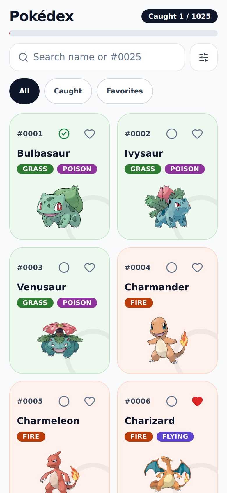
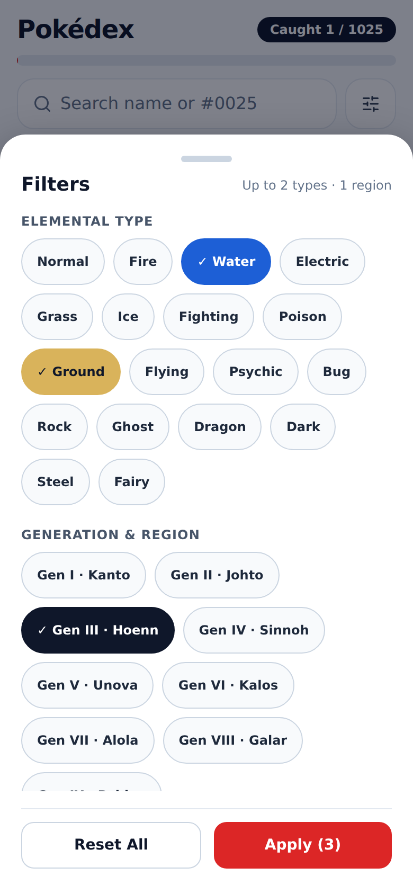
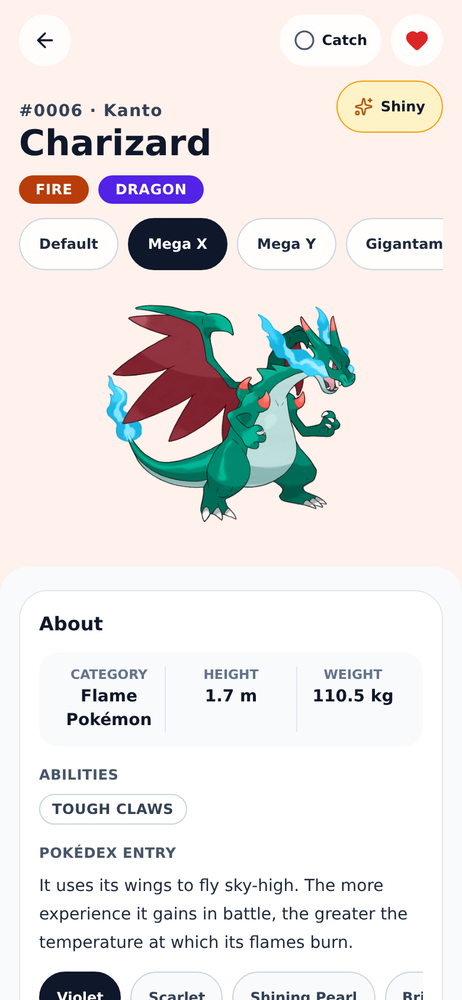
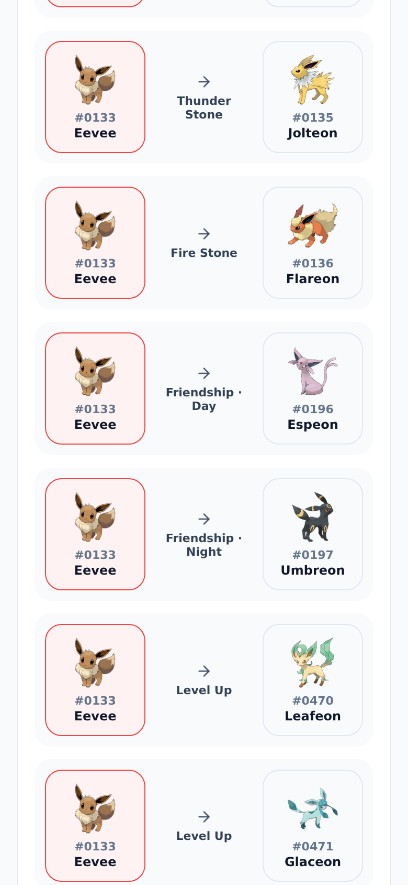

# Mobile Pokédex

A cross-platform **Pokédex** mobile application built with **React Native**, **Expo (SDK 58)**, **Expo Router**, **gluestack-ui + NativeWind**, and **TanStack Query**, covering all **1,025 National Dex species (Generations I–IX)** with offline-first caching, local collection tracking, and an end-to-end **Spec-Driven Development** workflow.

---

## Purpose

This project serves two goals:

1. **Cross-Platform Mobile Architecture Study:** Build a responsive, offline-resilient mobile app targeting **iOS**, **Android**, and **Web** from a single TypeScript codebase—demonstrating typed file-based navigation, virtualized infinite scrolling, persistent API caching, modular UI primitives, WCAG AA accessible color tokens, and clean separation between pure domain logic and UI/storage adapters.
2. **Spec-Driven Development Practice:** Design, clarify, plan, implement, converge, and verify the entire feature from structured specifications ([`specs/001-mobile-pokedex/`](./specs/001-mobile-pokedex/)) and project constitution ([`.specify/memory/constitution.md`](./.specify/memory/constitution.md)) using **GitHub Spec Kit**.

---

## Screenshots

Captured in a `390×844` mobile viewport via Playwright running against the Expo Web Metro bundle:

| National Dex Catalog | Filters Bottom Sheet | Mega & Shiny Form Switcher | Branching Evolution Chain |
| :---: | :---: | :---: | :---: |
|  |  |  |  |

Also captured: [Charizard Default Detail (`detail.png`)](docs/screenshots/detail.png).

---

## Features

- **National Dex Catalog (`#0001`–`#1025`, Gen I–IX):**
  - 2-column virtualized `FlatList` with automatic infinite scroll (24 Pokémon per batch), loading/retry footer, skeleton loading placeholders, and non-destructive pull-to-refresh.
  - Header progress bar and `Caught X / 1025` counter updated live.
- **Full-Catalog Search & Multi-Faceted Filtering:**
  - Persistent search bar matching species names and National Dex numbers (e.g., `#0025` → Pikachu) across the entire Gen I–IX index.
  - Inline collection-status pills (`All`, `Caught`, `Favorites`) plus one-tap `Clear All`.
  - Bottom-sheet filters (`Actionsheet`) supporting **up to 2 elemental types** (FIFO replacement cap across all 18 types) and **Generation / Region (`Gen I · Kanto` – `Gen IX · Paldea`)**.
- **Rich Pokémon Detail Screen (`/pokemon/[idOrName]`):**
  - Type-tinted hero header, **Default / Shiny** artwork toggle (with graceful notice when shiny artwork is missing), and conditional **Form Selector** for **Regional** (`Alolan`, `Galarian`, `Hisuian`, `Paldean`), **Mega**, and **Gigantamax** forms.
  - **About & Pokédex Entry:** Category, height, weight, regular & hidden abilities, and newest English flavor text with a game-version selector.
  - **Base Stats & Type Effectiveness:** 6 stat progress bars (`0–255`) with Base Stat Total and canonical **18×18 defensive type effectiveness** (`4×`, `2×`, `0.5×`, `0.25×`, `0×` immunities) that recalculates dynamically on form changes.
  - **Interactive Evolution Chain:** Linear and branching chains (such as Eevee) with evolution triggers and 1-tap navigation between stages.
- **Offline-First Caching & Local Collection Tracking:**
  - `Caught` and `Favorite` status tracked per base National Dex species via a swappable `CollectionStorageAdapter` backed by `AsyncStorage` (`pokedex:collection:v1`), shared seamlessly across alternate forms.
  - TanStack Query cache persisted to `AsyncStorage` (`24h` stale time, `7d` cache retention) with normalized error messages (`OFFLINE`, `NOT_FOUND`, `RATE_LIMITED`, `SERVER_ERROR`) and 1-tap retry controls.

---

## Tech Stack

| Layer | Technology |
| --- | --- |
| Framework & Runtime | React Native `0.88.1`, React `19.3.0`, Expo SDK `58`, TypeScript `6` |
| Navigation | Expo Router (`app/index.tsx`, `app/pokemon/[idOrName].tsx`) |
| UI & Styling | gluestack-ui modular components (`components/ui/*`), NativeWind `v4`, `lucide-react-native` |
| Media & Lists | `expo-image` (`memory-disk` cache policy), tuned 2-column `FlatList` |
| Data & Persistence | PokéAPI v2 (`pokeapi-client.ts`), TanStack Query + `@tanstack/query-async-storage-persister`, `AsyncStorage`, NetInfo |
| Testing | Jest `30` (`jest-expo`), `@testing-library/react-native` (`v14`), offline fetch guard & PokéAPI fixtures |

---

## Project Structure

```text
├── app/                          # Expo Router screens (_layout.tsx, index.tsx, pokemon/[idOrName].tsx)
├── components/ui/                # Modular gluestack-ui primitives styled with NativeWind
├── src/
│   ├── api/                      # PokéAPI v2 HTTP client, error normalizer & response mappers
│   ├── components/               # PokemonCard, FilterBottomSheet, TypeBadge, StatBarRow, EvolutionChainSection, StateFeedback
│   ├── domain/                   # Pure business logic: types, generations, route validation, search, 18×18 type chart
│   ├── hooks/                    # CollectionProvider/useCollection & TanStack Query hooks
│   ├── storage/                  # Swappable CollectionStorageAdapter (AsyncStorage & InMemory implementations)
│   └── theme/                    # WCAG AA (>= 4.5:1) color tokens for all 18 Pokémon types
├── __tests__/                    # Offline unit & screen integration test suites + fixtures
├── docs/screenshots/             # Playwright mobile UI inspection captures
├── specs/001-mobile-pokedex/     # Spec Kit spec, plan, contracts, data model, quickstart & tasks
└── LICENSE                       # MIT License
```

---

## Getting Started

### Prerequisites

- **Node.js** `>= 22.13`
- **Expo Go** (targeting **SDK 58**) on iOS or Android, or Xcode / Android Studio simulators

### Installation & Running

```bash
# 1. Install dependencies
npm install

# 2. Start Metro with a clean cache (scan QR code in Expo Go)
npx expo start -c
```

Target shortcuts:

```bash
npm run ios       # Open in iOS Simulator / Expo Go
npm run android   # Open in Android Emulator / Expo Go
npm run web       # Run in browser via Expo Web
```

### Verification Commands

```bash
npm run typecheck   # Run TypeScript check (tsc --noEmit)
npm test            # Run all 8 offline Jest suites (36 tests; live network blocked in tests)
npx expo-doctor     # Verify Expo SDK 58 dependency and config health
```

---

## License & Attribution

- Licensed under the [MIT License](./LICENSE) — Copyright (c) 2026 Lucas Mortoni.
- Pokémon data, sprites, and official artwork are sourced from the public [PokéAPI v2](https://pokeapi.co/). Pokémon and all related names/artwork are trademarks of Nintendo, Game Freak, and The Pokémon Company.
